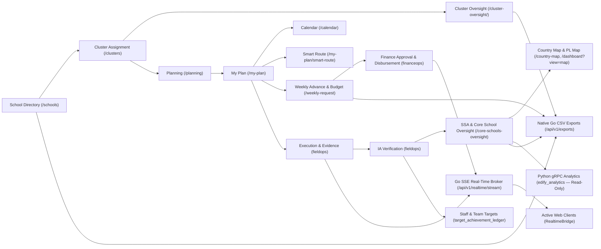

# Edify Ecosystem Dependency Map & Historical Functionality Baseline

**Audit Date:** 2026-11-22  
**Branch:** `feature/edify-go-rn-migration` (isolated worktree `qa/c3-20261122`)  
**Principle Verified:** One Authoritative Record (PostgreSQL) → One Canonical Operational Service (Go) → Scoped Real-Time Propagation (SSE) → Synchronized Web/Mobile Clients → Authoritative Exports & Isolated Python Analytics.

---

## 1. End-to-End Ecosystem Flow Graph

---

## 2. Functional Regression Baseline (Original vs Current State)

| Area | Original Location | Original Purpose | Current Location | Regression Status | Action Taken |
|---|---|---|---|---|---|
| School Directory Export | Page header `Export` button | Export filtered school list with Edify School ID | `/schools` → `/exports/school_directory?...` | **Broken (truncated at 500 rows, omitted district/cluster/filters)** | **Restored & Enhanced (`ECO-001`):** Raised cap to 50,000, added `edify_school_id`, `district`, `sub_region`, `cluster`, `enrollment`, and filter forwarding |
| Core School Oversight Export | Page header `Export` button | Export Core Schools with SSA & FY | `/core-schools-oversight` + `/exports/core_schools?fy=...` | **Preserved (UI) + Restored (Go API)** | Added native Go `core_schools` CSV export kind with `edify_school_id` & FY SSA |
| Cluster & Cluster School Exports | Cluster list & Cluster Oversight toolbars | Export clusters & member school lists with School ID | `/exports/clusters`, `/exports/cluster_schools`, `/exports/cluster-oversight/[section]` | **Preserved + Expanded** | Added `clusters` & `cluster_schools` native Go CSV kinds; fixed broken `/clusters/oversight/` tab link |
| Escalations / PTO / Field Debrief Exports | Page headers | Export scoped operational registers | `/escalations`, `/personal-time-off`, `/debriefs` | **Missing** | **Restored (`ECO-001`):** Added header `Export CSV` actions backed by native Go `/exports/escalations`, `/exports/leave_requests`, `/exports/debriefs` |
| Decision Log Export | Page header `Export Report` | Export audit & decision trail | `/decision-log` + `/exports/decision_log` | **Preserved + Restored (Go API)** | Backed by native Go `audit_log` CSV export (`17,662` rows verified) |
| Real-Time Operational Sync | Legacy Django `/realtime` announcer | Live updates across open tabs without manual refresh | Go `GET /api/v1/realtime/stream` + Next.js `/api/realtime` + `<RealtimeBridge />` | **Missing when Django offline** | **Restored natively in Go (`ECO-002`):** Role- & country-scoped SSE broker with `Last-Event-ID` replay |
| Country Map & PL Dashboard Map | `/country-map`, `/dashboard?view=map` | Sub-region UBOS choropleth, cohort KPIs, donut, top districts, CSV export | `/country-map`, `/dashboard?view=map` | **Restored & Reconciled** | Full UBOS GeoJSON choropleth + 30s FY TTL cache (`ECO-003`) |
| Sidebar Single Active Winner | Desktop sidebar (`Sidebar.tsx`) | Highlight only the active route | `Sidebar.tsx` | **Preserved** | Verified `<= 1` `aria-current="page"` across all 25 desktop routes |
| My Actions & Actions Sent | `/actions/mine`, `/actions/sent` | Scoped actionable queues | `/actions/mine`, `/actions/sent` | **Preserved** | Verified live (`HTTP 200`, scoped per user) |
